<div align="center">

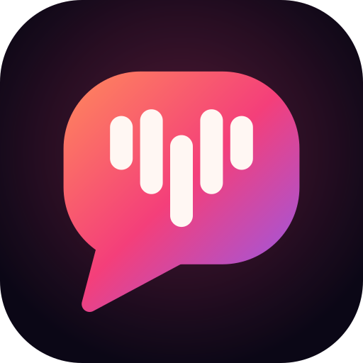

# Apni Awaaz · अपनी आवाज़

**Your own voice, back.**

**Live demo:** *[link]* · **One-page pitch:** [PITCH.md](PITCH.md)

For people who have lost their voice, or are losing it, to throat or oral cancer surgery, stroke, ALS/MND or Parkinson's.
Apni Awaaz rebuilds a person's own voice from old WhatsApp voice notes, then speaks for them in that voice in 10 Indian languages.

[-7c3aed)](#gnani-models-used-exactly)
[](#gnani-models-used-exactly)
[](#gnani-models-used-exactly)
[](#tests)
[](#accessibility)
[](#what-it-does)

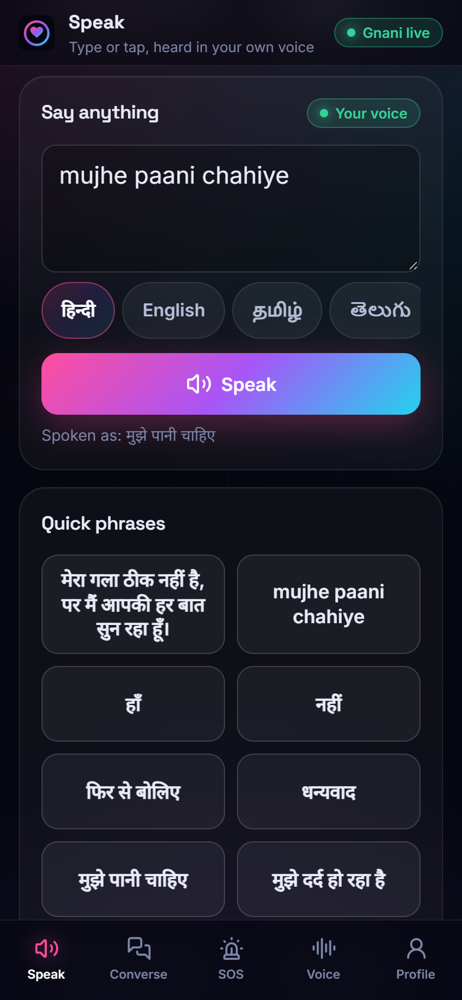&nbsp;
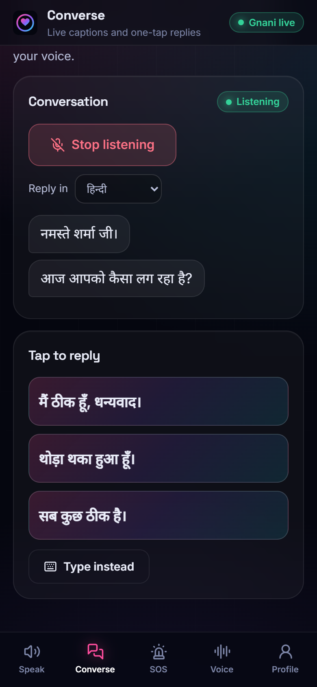&nbsp;
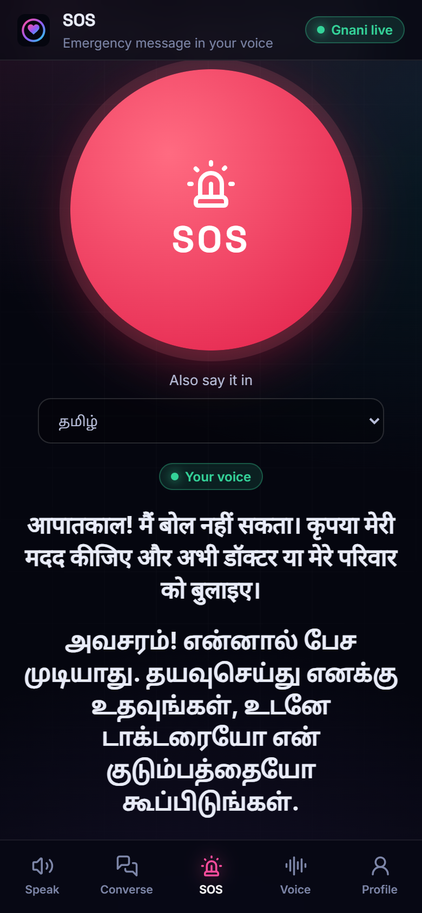

<sub>Real screenshots of the app running against Gnani's live APIs on 10 Nov 2026. The "old voice notes" in this demo are <b>synthetic</b>: we generated them with Gnani Timbre (voice <i>Shubham</i>). No real person's voice was cloned.</sub>

</div>

---

## The problem

Losing your voice is not only losing speech. It is losing the sound your family knows as *you*.

- **Nearly half of the world's oral cancer is in India.** GLOBOCAN 2024 estimates **2,05,878** new lip and oral cavity cancer cases in India. That is about **45.5%** of the world's 4,52,205 (our calculation from the two IARC sheets). It is the **most common cancer in Indian men** (1,59,734 cases). Sources: [IARC GLOBOCAN 2024, India fact sheet](https://gco.iarc.who.int/media/globocan/factsheets/populations/356-india-fact-sheet.pdf); [IARC lip and oral cavity fact sheet](https://gco.iarc.who.int/media/globocan/factsheets/cancers/1-lip-oral-cavity-fact-sheet.pdf).
- **Cancer of the voice box** adds **35,169** new cases a year in India ([same IARC India sheet](https://gco.iarc.who.int/media/globocan/factsheets/populations/356-india-fact-sheet.pdf)). When the voice box has to be removed (laryngectomy), the person can no longer speak in their own voice.
- **Stroke:** about **12.9 lakh** new strokes in India in 2019, and about **96.5 lakh** people living after a stroke ([Lancet study, via ThePrint](https://theprint.in/health/india-recorded-13-lakh-stroke-cases-in-2019-highest-in-southeast-asia-finds-lancet-study/1798324)).
- **Census 2011** counted about **20 lakh** people in India with a speech disability, including people born with one ([MoSPI 2016](https://www.mospi.gov.in/sites/default/files/publication_reports/Disabled_persons_in_India_2016.pdf)).
- **What people get today:** an electrolarynx (a mechanical buzz; ₹10,000 to ₹80,000 from [one Indian seller](https://m.indiamart.com/nrenterprisesindia)), a voice prosthesis, a notebook, or an app that speaks in a stranger's voice.

**Real stories**

- **Shrenik Shah** had his voice box removed in 1997 for stage IV vocal-cord cancer. He wrote on paper for three months, then taught himself to speak with an electrolarynx ([Cancerworld](https://cancerworld.net/shrenik-shah-the-voice-that-transcends-sound/)).
- **Sapna Rana**, a Radio Mirchi Mumbai voice for about 20 years, lost her speech to ALS. She rebuilt her own voice with ElevenLabs and now speaks Hindi and English with it, as reported from ElevenLabs' India summit ([CXOToday](https://cxotoday.com/media-coverage/elevenlabs-charts-next-phase-of-india-growth-at-first-summit-in-bengaluru/)).
- **Alice Harty** lost her voice after a laryngectomy. ElevenLabs rebuilt her voice from about three minutes of old recordings that family and friends sent in. She called it *"The greatest gift I could ask for"* ([WBUR](https://www.wbur.org/upnext/2026/08/13/artifical-intelligence-ai-voice-clone-cancer-als)).

Apni Awaaz follows Alice's path, old recordings in and your own voice out, and builds it for India: Indian languages and code-mix, everyday conversation, and no application step.

## What it does

### 1. Get your voice back from old voice notes
Tick consent, then upload 1 to 5 old WhatsApp voice notes (.opus, .ogg, .mp3, .wav) or record a new one. Each clip is checked before it is used: length of speech, clipping, background noise (SNR), and a Prisma v3.0 transcript to confirm there is clear speech. The clearest good clip becomes your voice with Gnani's zero-shot voice cloning, and you hear a test phrase straight away.

<p>
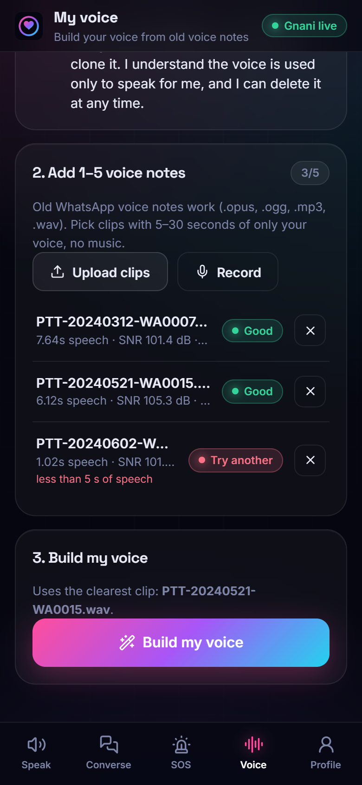&nbsp;
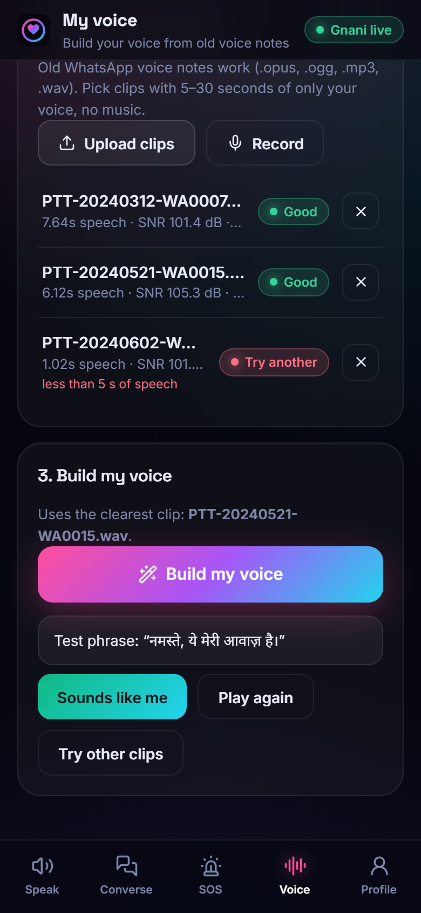
</p>

<sub>The two good clips show an SNR above 100 dB because these synthetic notes have perfectly silent gaps. Real voice notes score lower; the check asks for at least 15 dB.</sub>

### 2. Speak: type in any script, or tap a phrase
Type in Hindi, Tamil or any of 10 Indian languages, or in Latin letters ("mujhe paani chahiye"). Text in the wrong script is rewritten into the chosen language first, then spoken in your cloned voice. A badge always says honestly whose voice you heard: **Your voice**, **Fallback voice** (a Timbre voice, if cloning is unavailable) or **Phone's voice**. Quick phrases learn from what you say most.

<p>
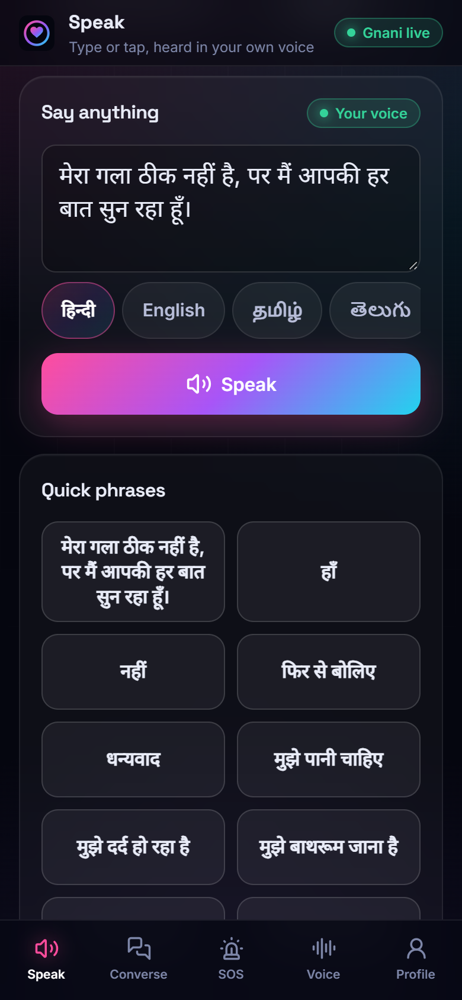&nbsp;
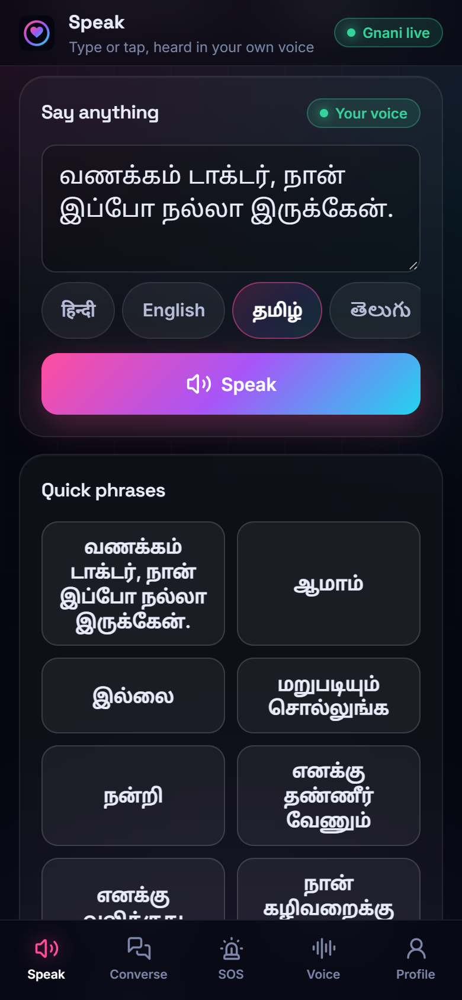
</p>

### 3. Banked messages and switch scanning
**Message banking:** record a few precious phrases before surgery ("I love you, beta", a laugh) or cut them from old notes. They play back exactly as recorded, with no AI. **Switch scanning:** for stroke and ALS users who cannot type or tap, a highlight steps through banked messages and phrases (fast, medium or slow). One press of Space, Enter, an assistive switch or the big Select button speaks the highlighted one.

<p>
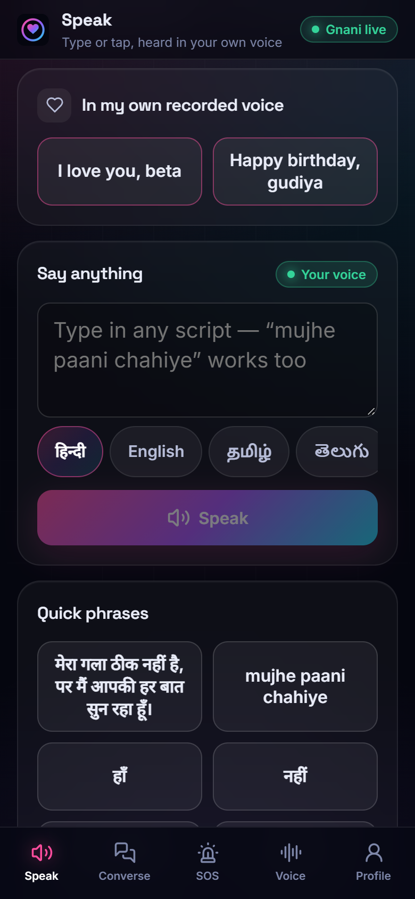&nbsp;
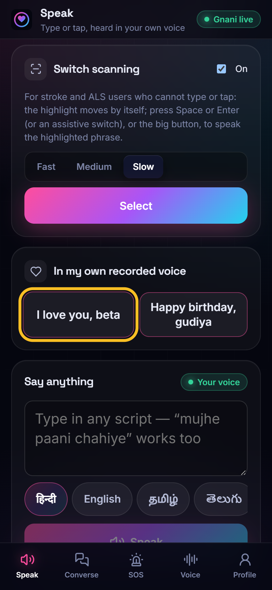
</p>

### 4. Converse: hear them, answer in one tap
Tap "Start listening". What the other person says appears as live captions (Prisma v3.0 streaming, Indian languages auto-detected). After each sentence, three short suggested replies appear in your language. One tap speaks the reply in your voice. Your own spoken replies are not captioned back (echo guard).

<p>
&nbsp;
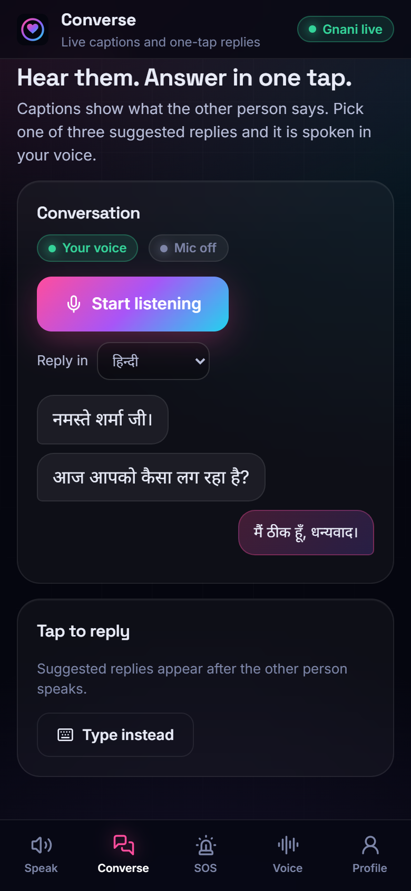
</p>

### 5. SOS, even when the server is down
One large button says an emergency message in your voice, in your language and a second language you pick, and shows it in large type. If Gnani or the server cannot be reached, the app still shows the message and reads it with the phone's own voice.

<p>
&nbsp;
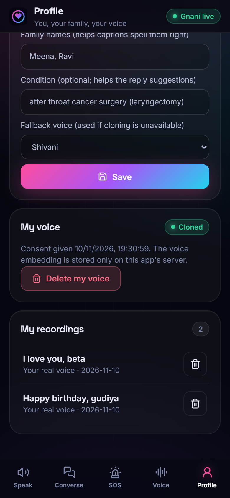
</p>

<details>
<summary><b>Desktop screenshots</b></summary>

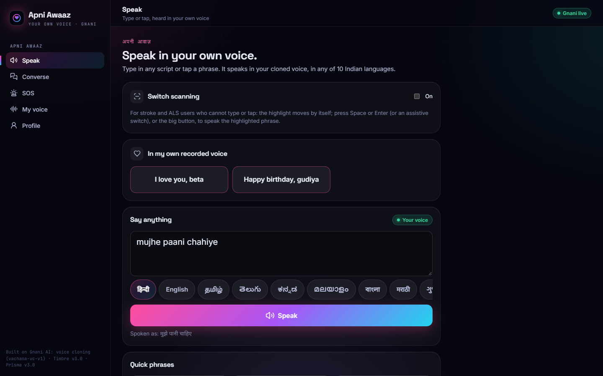
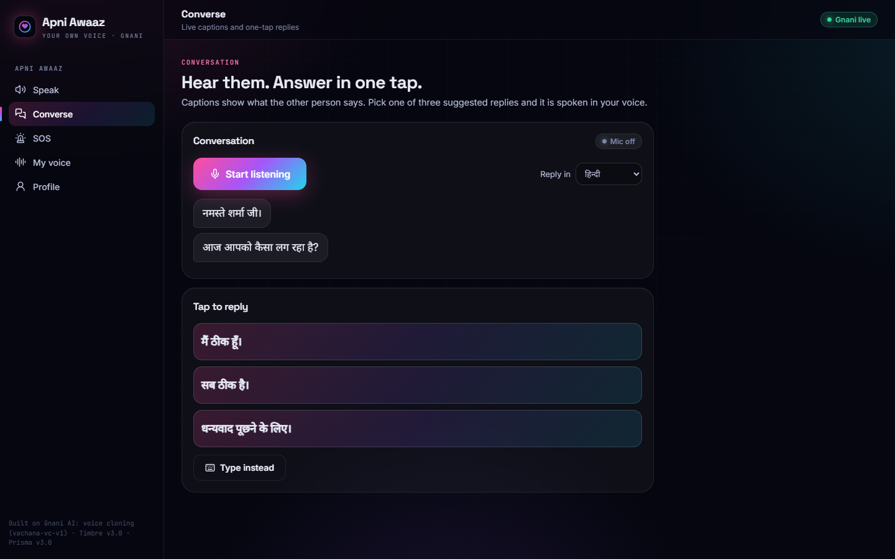
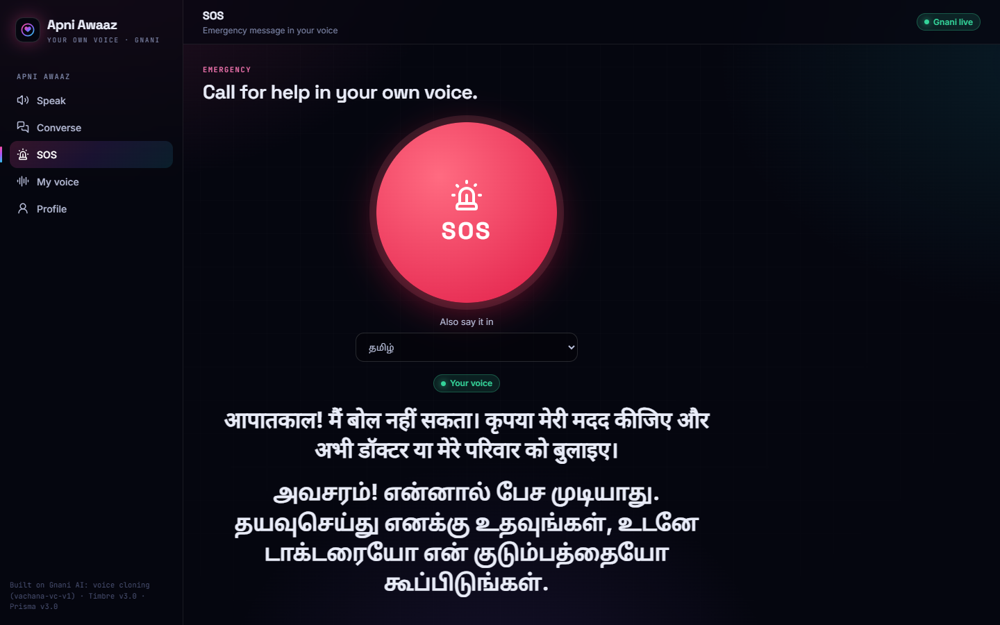
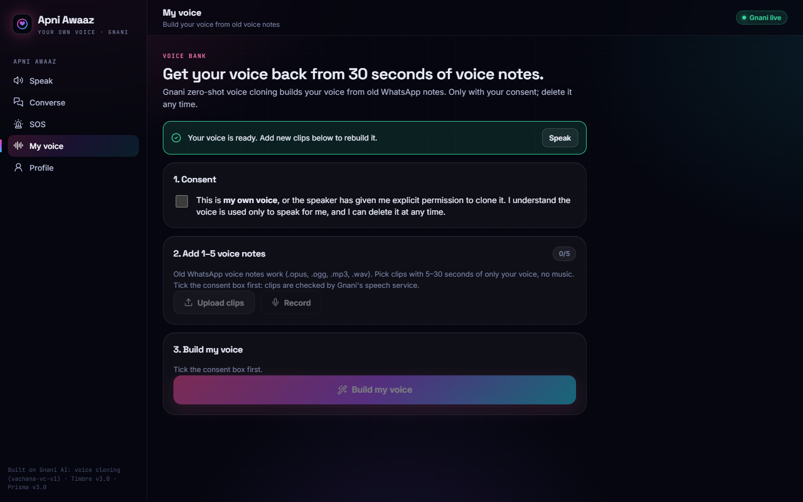
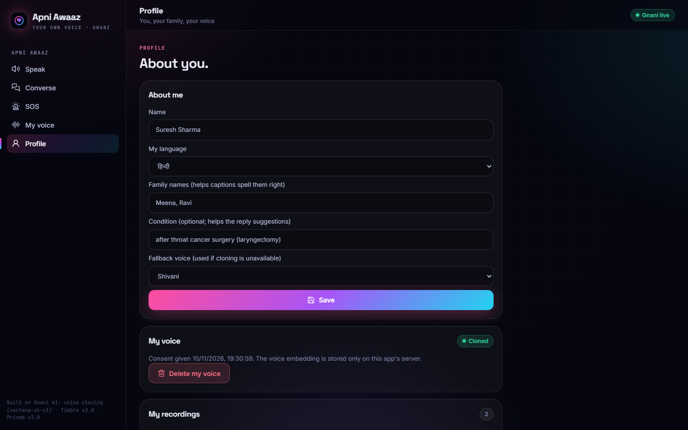

</details>

## How it's different

Good tools already exist, and we learned from them. Here is an honest comparison (facts as of Nov 2026, with sources).

| | Own voice | Works from recordings you already have | Indian languages | Conversation help (captions, suggested replies) | Cost |
|---|---|---|---|---|---|
| [Apple Personal Voice](https://www.apple.com/ios/feature-availability/) | Yes | No: needs a fresh recording session (10 phrases in iOS 26) made while you can still speak | None (English US, Spanish Mexico, Mandarin) | No | Free on Apple devices |
| [ElevenLabs Impact Program](https://www.technologyreview.com/2025/02/13/1111882/motor-neuron-diseases-took-their-voices-ai-bringing-them-back/) | Yes | Yes, including past WhatsApp voice messages (1 min minimum) | 14 Indian languages ([CXOToday](https://cxotoday.com/media-coverage/elevenlabs-charts-next-phase-of-india-growth-at-first-summit-in-bengaluru/)) | Not built around conversation, to our knowledge: it is a general voice platform | Free 5-year licence, [apply first](https://elevenlabs.io/blog/expanding-access-patients-and-clinicians-can-now-apply-directly-on-the-elevenlabs-website) |
| [Acapela My Own Voice](https://techcrunch.com/2023/05/08/acapela-lets-anyone-back-up-their-own-voice-for-free-in-minutes-just-in-case) | Yes | No: 50 new sentences (about 10 min) | 23 languages; we saw no Indian language in its list | No | Banking free, using the voice on a device is paid |
| [Avaz](https://avazapp.freshdesk.com/support/solutions/articles/1000213047) (Chennai) | Not a cloning tool | n/a | Indian languages, per Avaz (not re-checked by us) | Symbol and keyboard AAC | ₹299/month or ₹11,999 for life |
| [Jellow](https://apps.apple.com/in/app/jellow-aac-communicator/id1456459072) (IIT Bombay) | No: stock voices | n/a | English, Hindi, Bengali, Marathi, Tamil | Picture-based AAC | Free |
| **Apni Awaaz** | **Yes** | **Yes: direct voice-note import with a quality check, no application step** | **10 Indian languages, code-mix and romanised typing** | **Yes: live captions, 3 suggested replies, quick phrases, banked messages, switch scanning, SOS** | No charge to the user; whoever hosts it pays for the API calls |

**Where we fit.** Rebuilding a voice from old WhatsApp notes is not new: ElevenLabs already does it. To our knowledge, as of Nov 2026, no free, India-first phone app combines all three of:
1. rebuilding a person's own voice from voice notes they already have, with no new recording session, so it works after the voice is lost;
2. speaking in 10 Indian languages, including code-mixed and romanised typing;
3. a conversation mode with quick phrases, suggested replies and live captions, plus SOS that still works when the server is down.

## Gnani models used, exactly

| What | Gnani model / endpoint | Where in the code |
|---|---|---|
| Build the voice | **Voice cloning embeddings**, `POST /api/v1/tts/voice-clone/embeddings` (zero-shot, 5 to 30 s of reference audio) | `voice_core.gnani.create_voice_embedding`, called by `POST /api/voice/enroll` |
| Speak in the user's voice | **`vachana-vc-v1`** (`POST /api/v1/tts/inference` with the speaker embedding and a `language`) | `voice_core.gnani.tts_clone_rest`, used by `awaaz/speak.py` |
| Fallback voice | **Timbre v3.0** (`timbre-v3.0`, 13 voices, all 10 languages), used only when cloning is unavailable, and the badge says so | `voice_core.gnani.tts_rest` |
| Check a voice note | **Prisma v3.0** REST (`prisma-v3.0`, `codemix`) transcribes the clip to confirm clear speech | `POST /api/voice/clip-check` |
| Live captions | **Prisma v3.0** streaming WebSocket with `indic-auto`, family names as keyterms | `awaaz/converse.py` (`PrismaStream`) |

All Gnani REST calls go through one gate (one request at a time per key, with retries on 429), so a double tap never turns your voice into the fallback voice.

**LLM:** Groq `qwen/qwen3.8-27b` writes the three suggested replies and rewrites romanised or other-script text into the target language before it is spoken. Gnani's **Evon v3.3** is supported through the same interface (`LLM_PROVIDER=evon`, an OpenAI-compatible endpoint), but we do not host it: it needs an 80 GB GPU ([docs/EVON-HOSTING.md](docs/EVON-HOSTING.md)).

## Measured results

All numbers come from real runs against Gnani's live APIs with synthetic voices ([docs/test-log.md](docs/test-log.md)). Switch scanning is timed in the browser and does not call any API.

| Measure | Result | When |
|---|---|---|
| Build the voice (embedding call) | 0.67 s; 0.68 to 0.9 s on 8 Nov | 10 Nov, 8 Nov |
| Speak a sentence in the cloned voice | 1.2 to 1.65 s (a 2 s sentence in about 1.8 s) | 8 Nov |
| Cloned speech is understandable | All 7 clips spoken in the cloned voice on 10 Nov (Hindi and Tamil) were re-transcribed by Prisma word for word; "doctor" came back in Latin letters, as code-mix | 8 Nov, 10 Nov |
| Cross-language | Tamil spoken in the cloned voice of a Hindi speaker | 8 Nov, 10 Nov |
| Romanised input | "mujhe dawai chahiye" spoken as मुझे दवा चाहिए; "mujhe paani chahiye" spoken as मुझे पानी चाहिए | 8 Nov, 10 Nov |
| Captions and suggestions | Caption and 3 suggestions within about 1 s of each sentence | 8 Nov |
| Consent | Enrol without consent → HTTP 400 | 8 Nov |
| Switch scanning | Highlight moved through 4 phrases in 4.8 s | 8 Nov |
| Voice-note check (quality + Prisma transcript) | 0.27 to 0.69 s per clip; a clip with only 1 s of speech was flagged "less than 5 s of speech" | 10 Nov |
| Speak in the cloned voice, server time | 1.5 to 2.2 s for a Hindi, a romanised Hindi and a Tamil sentence; 1.3 s for a Converse reply; the first call after building took 4.0 s | 10 Nov |
| SOS in Hindi and Tamil, cloned voice | 7.1 s to make both messages (10.7 s of audio) | 10 Nov |
| Two Speak presses at the same moment | Both spoken in the cloned voice (2.0 s and 3.5 s, queued by the gate), no 429 | 10 Nov |
| Delete my voice | Embedding and consent cleared, 9 cloned clips on disk → 0, the next Speak used the fallback voice (0.6 s) | 10 Nov |
| Converse | Prisma captioned a synthetic nurse ("नमस्ते शर्मा जी।", "आज आपको कैसा लग रहा है?") and 3 fitting replies appeared | 10 Nov |

## How it works

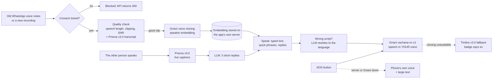

- **Backend:** FastAPI (`backend/awaaz/`), SQLite for the profile, embedding and banked recordings, and a disk cache so the same sentence is not synthesised twice. Audio made in the cloned voice has its own cache, so it can be wiped on delete.
- **Shared voice engine:** `voice-core/`, the same Gnani clients used by our other two products.
- **App:** React + Vite PWA (`frontend/`), phone-first, works on desktop.

## Privacy and consent by design

- **Consent is mandatory.** Upload and record stay disabled until the consent box is ticked, and the API itself refuses to build a voice without `consent=true` (HTTP 400). The consent time is stored and shown on the Profile page.
- **Delete my voice** removes the embedding and the consent record, and wipes every audio file made in the cloned voice. Banked recordings can be deleted one by one.
- **The voice embedding stays on the app's own server.** It goes out only to Gnani, inside each speech request, and is never sent to the browser.
- **What is sent to other services, and why:** audio goes only to Gnani, for the clip check, the embedding and speech. Text goes to the LLM (Groq) for suggested replies and for rewriting romanised text: the profile name, family names and condition, and the captions (text, not audio). Apni Awaaz stores nothing with any third party; their own retention policies apply to those calls.
- **Banked messages** are stored and played back as they are. No AI touches them.
- **Synthetic demo voice.** Every voice in our demos and screenshots was generated with Gnani Timbre. We never cloned a real person's voice for testing.

## Accessibility

- **Large tap targets:** phrase tiles 64 px, suggested replies 60 px, the Speak button 64 px, language chips 48 px, the SOS button 260 px.
- **Switch scanning** with Space, Enter, an assistive switch or the on-screen Select button, at three speeds. Typing in a text box never triggers it, and the highlight is never hidden under the tab bar.
- **Screen readers:** icon-only buttons have labels, captions are announced (`aria-live`), and so are error messages.
- **SOS works with the server down,** in the phone's own voice, with the message in large type.
- **Installable PWA** with a phone-first layout that also works on desktop. One reply at a time, so a shaky double tap never plays two messages over each other.
- Known gap: the scanning highlight is visual only; it is not yet announced to screen readers.

## Run it

Needs Python 3.12 with [uv](https://docs.astral.sh/uv/), and Node 20+.

```bash
uv sync --all-packages
cp .env.example .env          # add GNANI_API_KEY and GROQ_API_KEY
cd frontend && npm ci && npm run build && cd ..

# Live (real Gnani + Groq). On Windows, "python -m" avoids blocked .exe launchers.
uv run python -m uvicorn awaaz.app:create_app --factory --host 127.0.0.1 --port 8767
# open http://127.0.0.1:8767

# Fake mode: no API keys. Tones stand in for speech and a scripted nurse talks.
AWAAZ_FAKE=1 uv run python -m uvicorn awaaz.app:create_app --factory --host 127.0.0.1 --port 8767
```

Static demo with no backend, as on the live link (it replays a recorded session): `cd frontend && npm run build:demo`, then serve `frontend/dist`. See [docs/DEPLOY-VERCEL.md](docs/DEPLOY-VERCEL.md).

PowerShell: run `$env:AWAAZ_FAKE = "1"` first, then the same command. For frontend development, `npm run dev` in `frontend/` serves on port 5193 and proxies API calls to the backend.

## Tests

```bash
uv run python -m pytest -q     # 92 passed
```

- **App (30 tests):** consent is required before a voice is built; voice-note checks (too short, clipping, noise, no clear speech, a long note judged on the 30 s actually used); romanised Hindi rewritten then cloned; clone failure falls back to Timbre; Delete my voice also deletes cloned audio; SOS in two languages, and SOS text returned when speech fails; message banking keeps the original recording; live captions with suggested replies and the echo guard; parallel Speak presses never overlap Gnani calls, and a 429 is retried without losing the cloned voice.
- **Shared voice engine (62 tests):** Gnani protocol (headers, embeddings, TTS bodies), the request gate and retries, audio utilities, the LLM wrapper, turn handling and the realtime session.
- `npm run build` checks the app compiles. The app was also tested end to end in headless Chrome with a fake microphone.

## Docs

- [docs/02-design.md](docs/02-design.md): design and decisions
- [docs/01-gnani-api-reference.md](docs/01-gnani-api-reference.md): the Gnani APIs we use
- [docs/test-log.md](docs/test-log.md): live test results
- [docs/review-cl-2026-11-10.md](docs/review-cl-2026-11-10.md): final review, 16 findings and their fixes
- [docs/06-demo-and-post.md](docs/06-demo-and-post.md): demo script
- [docs/EVON-HOSTING.md](docs/EVON-HOSTING.md): how to host Evon v3.3
- [docs/DEPLOY-VERCEL.md](docs/DEPLOY-VERCEL.md): the static live demo (replays a recorded session, no backend) and how to refresh it
- [docs/START-HERE.md](docs/START-HERE.md): for contributors

## Team and family

Design and shared voice engine: **Nitya Prakash Pandey**. Implementation and live testing: **Dilavesh Kanz Nidooli**. Final review and hardening: **Nitya Prakash Pandey**.

Part of a three-product entry built on one Gnani voice engine: [Dadi vs Scammers](https://github.com/nitya-prakash-pandey-2005/dadi-vs-scammers), [Pukaar](https://github.com/nitya-prakash-pandey-2005/pukaar), and Apni Awaaz.

Built for Gnani AI's *Great Indian AI Internship Challenge*. #GnaniAI #GreatIndianAIInternshipChallenge
