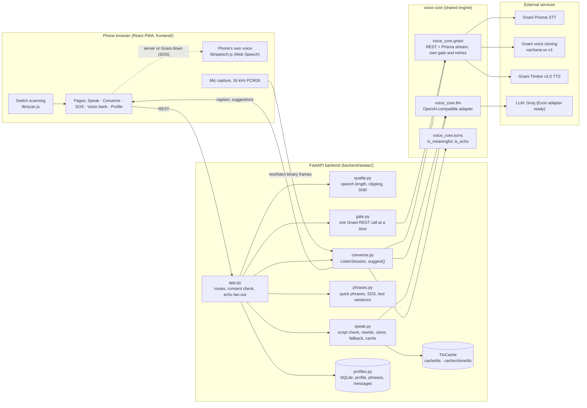
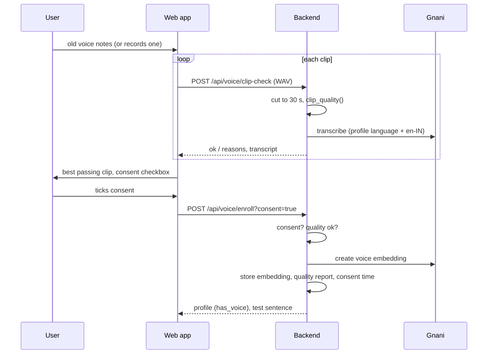

# Apni Awaaz architecture

Apni Awaaz is a phone-first web app (React PWA, `frontend/`) in front of one FastAPI backend (`backend/awaaz/`),
which uses the team's shared voice engine (`voice-core/`) for every call to Gnani and to the LLM. All state lives
on the backend's device: one SQLite database and one audio cache folder. The REST and WebSocket contracts are in
[API.md](API.md); this page explains how the parts fit and why.

## Components

| Module | Responsibility |
|---|---|
| `app.py` | `create_app()` wires settings, store, caches, LLM and the four Gnani REST functions (real or fake), wraps those in the gate, and defines every route. It holds the set of open listen sessions so speech can be fanned out to the echo guard. |
| `quality.py` | `clip_quality()` scores a voice note from the signal alone; `best_clip()` picks the highest-SNR clip that passed. |
| `speak.py` | `speak()` turns text into a WAV in the cloned voice, falling back to Timbre; `rewrite()` transliterates or translates text whose script does not match the output language. |
| `converse.py` | `ListenSession` runs one conversation socket; `suggest()` asks the LLM for 3 replies and always returns 3. |
| `profiles.py` | `ProfileStore`: one profile row (JSON), phrase-use counts and banked recordings in SQLite. |
| `phrases.py` | Built-in quick phrases, SOS sentences and the enrolment test sentence (Hindi, English, Tamil; other languages use English and are translated by `speak()`). |
| `gate.py` | `GnaniGate`: serialises the app's Gnani REST calls and retries a `429` twice (0.5 s, then 1.5 s). |
| `fake_mode.py` | `AWAAZ_FAKE=1`: the same app with tones for speech, a hashed embedding, a fixed transcript, a scripted nurse and an echoing LLM. Used for keyless demos and by the tests. |

`create_app(settings, llm=..., stt_factory=...)` takes its dependencies as arguments, so tests inject fakes for the
LLM and the speech-to-text stream without patching module globals.

## Enrolment: quality check, consent, embedding

1. **Quality check** (`quality.py`). The clip is cut to its first 30 s (`MAX_CLIP_S`), because Gnani cloning takes
   5 to 30 s of reference audio and only that much is sent. RMS is measured in 20 ms frames; the 10th percentile is
   taken as the noise floor and the 90th as speech level, giving an SNR estimate. A frame counts as speech above
   twice the noise floor. The clip fails on under 5 s or over 30 s of speech, 1 % or more clipped samples, or an
   SNR under 15 dB. `clip-check` adds Gnani's transcript and fails a clip with no meaningful words; a transcript
   failure is logged and does not block the check.
2. **Consent.** `enroll` refuses with `400` unless `consent=true`, before it even reads the audio. The web app keeps
   upload and record disabled until the consent box is ticked, but the server does not trust the client.
3. **Embedding.** The clip is re-checked on the server (a client cannot skip the quality gate), then sent to Gnani
   once. The returned embedding, the clip's quality report and the consent time (UTC) are saved together by
   `ProfileStore.set_voice()`. If cloning fails the route returns `502` and nothing changes: the fallback voice
   stays on.

## Speak: rewrite, cloned voice, fallback, cache

`speak()` in `speak.py`, used by `/api/speak` and `/api/sos`:

1. **Script check and rewrite.** `script_of()` finds the dominant Unicode script of the text and `needs_rewrite()`
   compares it with the scripts the output language uses (Devanagari for Hindi and Marathi, Latin for English, and
   so on). Only on a mismatch does the LLM rewrite it: transliterate if it is the same language in Latin letters
   (`mujhe paani chahiye`), translate otherwise. Results are memoised per (text, language) for the process. If the
   LLM fails or returns nothing, the original text is spoken.
2. **Cloned voice.** With an enrolled voice, the cache key is built from the spoken text, a short hash of the
   embedding, the language and the sample rate; on a miss Gnani `vachana-vc-v1` is called through the gate and the
   PCM is cached in the **clone cache** (`cache/clone/tts`).
3. **Fallback.** If cloning fails (logged, not raised) or there is no voice, Timbre v3.0 speaks with the profile's
   fallback voice, cached in the shared TTS cache (`cache/tts`). The response header `X-Voice` tells the user which
   voice they heard, so a fallback is never passed off as their own voice.
4. **Cache.** Repeated phrases ("I need water") are paid for once and play instantly. Cloned-voice audio is kept in
   its own folder so that deleting the voice can delete all of it.

After speaking, the backend tells every open listen session what was said (echo guard, below), and `/api/speak`
counts the sentence for the user's most-used phrases.

## Converse: captions, echo guard, suggestions

One `ListenSession` per `/ws/listen` socket (`converse.py`):

- **Captions.** Microphone PCM goes to Gnani Prisma streaming (`STT_MODE=stream`, language auto-detect) or to
  turn-based recognition (`STT_MODE=turn`). The user's name and family names are sent as key terms so they are
  recognised. Each meaningful transcript becomes a partner turn and a `caption` message.
- **Echo guard.** On a speakerphone the microphone hears the app's own reply. `app.say()` calls
  `note_spoken()` on every live session, and a transcript that `voice_core.turns.is_echo()` matches against the
  last two spoken sentences is dropped instead of being captioned as the other person. Tests: `test_echo_dropped_partner_captioned_with_suggestions`
  (session level) and `test_what_the_app_says_is_not_captioned_as_the_other_person` (through `/api/speak` and the socket).
- **Suggestions.** After each caption, `suggest()` sends the last 6 turns plus who the user is (name, condition,
  family names) and asks for exactly 3 replies of at most 8 words in the profile language, as JSON. A new caption
  cancels a suggestion still being generated, so suggestions always answer the latest thing said. Anything other
  than 3 short non-empty strings is rejected and replaced by the user's top phrases and the built-in ones.
- The user replies by tapping a suggestion, which goes through `/api/speak` like any other sentence.

## SOS

`/api/sos` speaks `sos_text()` in the profile language and, if different, in the local language chosen on the SOS
page, joined into one WAV with 0.6 s gaps, through the same `speak()` path (cloned voice when available). It is
designed to work when everything else fails:

- If any part fails, the `502` body carries the languages and the sentences, and the SOS page reads them aloud with
  the phone's own voice (Web Speech API, `frontend/src/lib/speech.js`) and shows them in large type.
- If the server cannot be reached at all, the page has a built-in English message and does the same.

## The Gnani gate

Gnani allows one short request at a time per key; a concurrent second request gets `429 RATE_LIMITED` (live check,
8 Nov 2026; an open Prisma stream plus one REST call is fine). There are two layers:

- **App level, `backend/awaaz/gate.py`.** `create_app()` wraps the four REST functions it uses (clip transcript,
  voice embedding, cloned TTS, Timbre TTS) with one `GnaniGate`: an `asyncio.Lock` so the app never has two in
  flight, and two retries of a `429`. Without it, a double tap or a switch press during an SOS would make the clone
  call fail and `speak()` would silently answer in the fallback voice. Tests:
  `test_parallel_speaks_never_overlap_gnani_calls`, `test_a_429_is_retried_and_keeps_the_cloned_voice`.
- **Engine level, `voice_core/gnani/gate.py`.** voice-core's REST functions also run inside its own semaphore
  (`GNANI_MAX_CONCURRENT`, default 1) with retries on rate limits and 5xx, and a 20 s wait limit so a stuck holder
  cannot block the app. The Prisma stream is not gated.

## Privacy and consent enforcement

| Rule | Where it is enforced | Test |
|---|---|---|
| No voice without consent | `enroll()` in `app.py` returns `400` unless `consent=true`; checked before the audio is read | `test_enroll_needs_consent_then_speaks_in_clone_voice`, `test_consent_is_checked_before_the_audio` |
| Consent is recorded | `ProfileStore.set_voice()` stores the UTC consent time with the embedding | `test_profile_store_roundtrip`, `test_set_voice_records_consent_and_delete_clears_it` |
| The embedding never reaches the browser | `public()` in `app.py` drops `voice` from every profile response and exposes only `has_voice` | `test_health_and_profile`, `test_keys_and_the_embedding_never_leave_the_server` |
| Delete means delete | `DELETE /api/voice` clears the embedding, its quality report and the consent time, and removes the clone cache folder | `test_delete_voice_also_deletes_audio_made_in_that_voice` |
| Banked recordings are untouched | Stored and returned byte for byte with their media type | `test_message_banking_keeps_the_original_recording` |
| Only the first 30 s leave the device | `wav_in()` cuts every uploaded clip before it is judged or sent | `test_long_voice_note_is_judged_on_the_30_s_actually_used` |

Audio goes only to Gnani; text (captions, the profile's name, family names and condition, romanised input) goes
only to the configured LLM. Keys are read from `.env` by `voice_core.config` and never returned by any route
(`/api/health` reports only whether they are set).

## Accessibility architecture

- **Switch scanning** (`frontend/src/lib/scan.js`, `useScan`): a timer steps a highlight through banked messages
  and phrases at three speeds; Space or Enter (what most assistive switches send) or a large on-screen button
  selects. Key presses inside text inputs are ignored so typing never triggers a selection.
- **One reply at a time:** `useSpeak()` in `frontend/src/lib/api.js` ignores a new sentence until the current one
  has finished playing, so a shaky double tap or a second switch press does not play two messages over each other;
  on the server the gate serialises the Gnani calls behind them.
- **Screen readers:** captions and errors are announced with `aria-live`; icon-only buttons have labels.
- **Large targets and reduced motion:** big tap targets for phrases, replies and SOS; animations are cut under
  `prefers-reduced-motion` (`frontend/src/styles/base.css`).
- **Indian scripts:** Noto Sans Devanagari, Tamil and Bengali are bundled, so phrases render without system fonts.

## Failure handling

| Failure | Behaviour |
|---|---|
| Gnani busy (`429`) | Retried by the app gate (twice) and by voice-core's gate; the user still hears their own voice |
| Cloned TTS fails | Timbre fallback voice; `X-Voice: fallback` so the app shows which voice spoke |
| Fallback TTS fails too | `/api/speak` returns `502`; `/api/sos` returns `502` with the texts for the phone's own voice |
| LLM down or bad output | Rewrite: the original text is spoken. Suggestions: top and built-in phrases |
| Clip transcript fails | Clip check returns the signal-only verdict with `text: null` |
| Voice cloning fails | `502`; the profile is unchanged and the fallback voice stays on |
| STT stream drops | `status: error/closed` to the client; the user taps the mic again (no automatic reconnect yet) |
| Session crashes | `status: error` with the message; the session is closed and removed from the echo fan-out |
| Bad input | `400` (empty text, unsupported language, not a WAV, no label), `413` (recording over 8 MB), `422` (clip quality) |
| No keys at all | `AWAAZ_FAKE=1` runs the full app offline; the static demo build replays a recorded session |

## Testing

`uv run python -m pytest -q` runs the voice-core and backend suites with no keys and no network: the app tests use
fake mode plus injected fakes (`voice_core.testing.FakeLLM`, `FakeStt`). CI (`.github/workflows/ci.yml`) runs the
same tests on Ubuntu and builds the web app in both modes.
